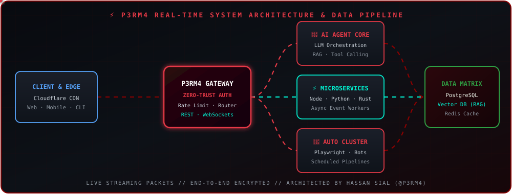

<!-- =========================================================
     HASSAN SIAL (@p3rm4) — ULTRA INSTINCT GITHUB PROFILE
     github.com/p3rm4
========================================================== -->

<!-- 🔥 GOKU MASTERED ULTRA INSTINCT HERO ANIMATION -->

# HASSAN SIAL™

 

<code>BUILDING INTELLIGENT SYSTEMS FROM MODEL → API → INFRASTRUCTURE → INTERFACE</code>

  

## 🖥️ `> root@p3rm4:~# ./live-neural-kernel`

<!-- ⚡ 0.01% PRO-LEVEL ANIMATED HACKER TERMINAL + SPINNING REACTOR HUD -->

## 📡 Live Data-Flow & System Architecture

<!-- ⚡ 0.01% PRO-LEVEL ANIMATED CIRCUIT ARCHITECTURE WITH FLOWING PACKETS -->

## 🚀 What I Build

<table>
<tr>
<td width="50%" valign="top">

**[🧠 AI Agents & Intelligent Systems](https://github.com/p3rm4?tab=repositories)** 
Autonomous LLM workflows, multi-model routing, and RAG pipelines built for real-world execution.

</td>
<td width="50%" valign="top">

**[🌐 Full-Stack Web Architecture](https://github.com/p3rm4?tab=repositories)** 
High-speed web applications with reactive interfaces, real-time APIs, and scalable cloud backends.

</td>
</tr>
<tr>
<td width="50%" valign="top">

**[🤖 Smart Automation Engines](https://github.com/p3rm4?tab=repositories)** 
Headless browser clusters (`Playwright`) and automated workflows that eliminate manual repetition.

</td>
<td width="50%" valign="top">

**[🔐 Cybersecurity & Hardened Systems](https://github.com/p3rm4?tab=repositories)** 
Zero-trust API design, attack-surface analysis, and defensive system engineering.

</td>
</tr>
</table>

## ⚙️ Tech Stack

## 🏆 GitHub Telemetry & Activity Matrix

<picture>
  <source media="(prefers-color-scheme: dark)" srcset="https://streak-stats.demolab.com?user=p3rm4&theme=dark&hide_border=true&background=0D1117&ring=E63946&fire=E63946&currStreakLabel=E63946" />
  
</picture>

  

## `HASSAN SIAL™`

**AI · FULL-STACK · CYBERSECURITY · AUTOMATION**

CODE THE SYSTEM · SECURE THE SYSTEM · SCALE THE SYSTEM

