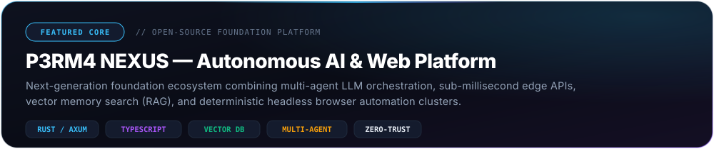

  

  

  

  

  

  

<picture>
  <source media="(prefers-color-scheme: dark)" srcset="https://streak-stats.demolab.com?user=p3rm4&theme=dark&hide_border=true&background=090B12&ring=38BDF8&fire=A855F7&currStreakLabel=38BDF8&sideLabels=94A3B8&dates=64748B" />
  
</picture>

  

